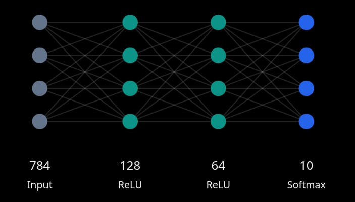

 # MNIST Neural Networks from First Principles
## Mathematical Foundations, Implementation, and Computational Analysis
### Independent Computational Mathematics and Machine Learning Project

## Overview

### What the project is

Using the MNIST handwritten digit dataset, I built a multilayer neural network to explore forward propagation, backpropagation, activation functions, loss computation, and optimization. The goal isn't simply to classify handwritten digits, but to understand how each mathematical operation contributes to the learning process.

### Motivation

The increasing accessibility of machine learning frameworks has significantly simplified the implementation of neural networks. However, these abstractions can obscure the underlying mathematical operations, particularly for individuals attempting to understand how neural networks learn and optimize their parameters. The whole purpose of the project is to learn the core ideas or the fundamental mathematics of a neural network.

### Methodology

The project serves as a tangible output while learning the fundamental mathematics used for Artificial Intelligence, by building it from the ground up using Pure Python implementation, without using any NumPy and PyTorch or TensorFlow libraries throughout the start. 

The project also encourages the use and need for low level implementations of several functions, such as a summation function made with pure python, or the crucial mathematical functions used in Machine Learning, such as the dot product, softmax and more.

## Chapter I

## Mathematical Principles

### <ins>Linear Algebra</ins>

In programming, linear algebra has been widely used especially with game development. What actually is the difference between linear algebra and the traditional and usual algebra we learned during high school and college? And why do we need this for Artificial Intelligence as well?

The core idea is that the algebra we know only solves one problem at a time. What makes linear algebra so special is that it allows multiple calculations to happen all at once. And since we are dealing with multivariable problems when it comes to game development or artificial intelligence, linear algebra is crucial in these cases.

#### <ins>Vectors</ins>

In neural networks, vectors are seen differently than how they are in math and physics. In math, they are seen as arrows, a quantity that has both magnitude and direction. In our case, we refer to it as containers for data. It is an array of numbers where it represents a specific attribute or feature. 

Take this equation for example

$$ \mathbf{x} =  
\begin{bmatrix} 
x_1 \\ 
x_2 \\ 
x_3 
\end{bmatrix} $$

We can say that the whole vector is an object. While $x_1$, $x_2$, $x_3$ is the features of the object. Suppose that object is a chair, we could say that $x_1$ is representing the legs of a chair, then $x_2$ is whether the chair has a backrest or not, and $x_3$ could be if the chair is portable or not.

#### <ins>Matrices</ins>

Like vectors, a matrix is an array of numbers and information that serves as containers for the data that we need in neural networks.

There are two use cases for the matrix:

1.) Containers of data - storing and representing a series of valuable data (an example would be a data set)

2.) Containers of weights - a weight represents the neuron's ability to influence relative to the received input (most common use case)

Consider this equation:

$$
\mathbf{A} = 
\begin{bmatrix}
x_1 & y_1 & z_1 \\
x_2 & y_2 & z_2
\end{bmatrix}
$$

Where $A$ can be a representation of several objects with their own features, take $x_1$ and $x_2$ for example; they are on the same column, which can also be represented as a vector. While $y$ and $z$ also operate on the same idea. They can conceptually mean that, matrix $A$ contains three objects of the same kind with two features for each. This is how matrices are used as data sets. 

As for how matrices is used commonly in neural networks, which are storing weights. It is a bit different than how it is used as data sets.

Consider this matrix $W$:

$$
\mathbf{W} =
\begin{bmatrix}
0.1 & 0.25 & 0.6 & 0.12 \\
0.23 & 0.43 & 0.23 & 0.11 \\
0.54 & 0.68 & 0.13 & 0.25
\end{bmatrix}
$$

On its own, it simply looks like a matrix with a bunch of numbers in it. Unlike data sets, where the values stored in a matrix is a vector whose use and what it represents are something that we inform beforehand. When storing weights, it is entirely different; it is a bunch of digits distributed randomly in each of their place in the matrix. To understand, knowing why weights are randomly initialized first is important.

### <ins>Neurons</ins>

Neural network is based on the biological neurons humans have, although artificial; it somewhat copies the "learning" process of a neuron. So we form a mathematical concept for these neurons in our program. 

Consider this matrix again: 

$$
\mathbf{W} =
\begin{bmatrix}
0.1 & 0.25 & 0.6 & 0.12 \\
0.23 & 0.43 & 0.23 & 0.11 \\
0.54 & 0.68 & 0.13 & 0.25
\end{bmatrix}
$$

Each column, is the weights of a neuron. And the digits inside that weight is what makes a neuron distinguish an input, at least when trained. In this case, or rather, in most case; the weights are initialized in random as a "raw" representation of an untrained neuron. 

#### <ins>The Mathematical Formula of a Neuron</ins>

$$
z = Wx + b
$$

##### This is the most fundamental formula in neural networks

So why is it initialized in random? What exactly are the weights?

#### <ins>Weights</ins>

This is what the matrix $W$ represents on the mathematical formula of a neuron. It is a matrix filled with digits distributed randomly at first. It is random because it crosses out symmetry on the weights. Imagine if all weight values are equal, then the results would be identical as well. This is will make sense later on when the idea of updating the weights is introduced. 

In this matrix: 

$$
\mathbf{W} =
\begin{bmatrix}
0.1 & 0.25 & 0.6 & 0.12 \\
0.23 & 0.43 & 0.23 & 0.11 \\
0.54 & 0.68 & 0.13 & 0.25
\end{bmatrix}
$$

Each digits in a row represents the weights of that neuron. 

#### <ins>Inputs</ins>

This is what $x$ is representing on the mathematical formula of a neuron. Most of the time, it is a vector; but there are cases where it is a matrix as well. But in this project, it is usually a vector containing the features and data of an input. 

Consider this vector:

$$
\mathbf{x} = 
\begin{bmatrix}
0.98 \\
0.45 \\
0.32 \\
0.12 
\end{bmatrix}
$$

This is an example of an input where it has four features. It represents the data of an input mathematically. 

#### <ins>Bias</ins>

For the bias where it represents the $b$ on the neuron formula, the primary reason is purely mathematical. Consider the mathematical formula for the neuron $z = Wx + b$. If we removed $b$, the origin for each would be at (0, 0), making it harder for the network to distinguish patterns and is limited only to that certain origin. By adding a bias, the boundaries can be placed anywhere on the graph, as it "shifts" the equation. Which is why the formula for a neuron is $z = Wx + b$. 

Consider this vector:

$$
\mathbf{b} = 
\begin{bmatrix}
0.2 \\
0.5 \\
0.1 
\end{bmatrix}
$$

One thing you will notice is that the number of rows in a bias is also the same number of rows a weight has. It is because, for each neuron, it has one bias value for each. And we have already established that the number of rows in a matrix containing weights, is the number of neurons there is. 

When combined, the equation eventually looks like this:

$$
z = Wx + b
$$

$$
z = 
\begin{bmatrix}
0.1 & 0.25 & 0.6 & 0.12 \\
0.23 & 0.43 & 0.23 & 0.11 \\
0.54 & 0.68 & 0.13 & 0.25
\end{bmatrix}
\begin{bmatrix}
0.98 \\
0.45 \\
0.32 \\
0.12 
\end{bmatrix} + 
\begin{bmatrix}
0.2 \\
0.5 \\
0.1 
\end{bmatrix}
$$

This is what a neuron operations looks like mathematically. 

You will also notice that the input vector is the only one that isn't symmetrically aligned to both weights and biases. It is the only one with 4 features while the weights and biases only has three. 

### Linear Transformations

#### Scalar to Vector Operations

Now we will introduce the first fundamental operations in linear algebra that is essential for neural networks and is the key to understanding why the mathematics inside a neural network works.

Consider this equation:

$$
c = 4 \qquad
\mathbf{v} = 
\begin{bmatrix}
0.3 \\
0.2 \\
0.1 
\end{bmatrix}
$$
$$
c(\mathbf{v}) = 
4
\begin{bmatrix}
0.3 \\
0.2 \\
0.1 
\end{bmatrix}
$$
$$
c(\mathbf{v}) = 
\begin{bmatrix}
4(0.3) \\
4(0.2) \\
4(0.1) 
\end{bmatrix}
$$

This is an example of a scalar to vector operations, the scalar multiplies every feature of a vector by itself.

But in neural networks, we aren't dealing with just a single digit, but a lot of them. So we do an operation one step further. 

#### Dot Product

We have tackled what scalar to vector operations looks like, but what if it’s a vector to vector, or even a vector to matrix operations? That’s what dot product is. Instead of one value affecting a vector, there are several at once. And knowing how it works and behaves is crucial to understanding how the entire neural network operates without abstraction.

Consider this equation: 

$$
\mathbf{W} = 
\begin{bmatrix}
0.1 & 0.25 & 0.6 & 0.12 \\
0.23 & 0.43 & 0.23 & 0.11 \\
0.54 & 0.68 & 0.13 & 0.25
\end{bmatrix}
\qquad
\mathbf{x} =
\begin{bmatrix}
2 \\
3 \\
1 \\
5
\end{bmatrix}
$$

Let:

$$
\mathbf{Wx} =
\begin{bmatrix}
0.1 & 0.25 & 0.6 & 0.12 \\
0.23 & 0.43 & 0.23 & 0.11 \\
0.54 & 0.68 & 0.13 & 0.25
\end{bmatrix}
\begin{bmatrix}
2 \\
3 \\
1 \\
5
\end{bmatrix}
$$

Unlike scalar to vector where it has one feature, and we only need to multiply that feature to the features inside a vector or a matrix; for a dot product, it is commonly used when a case like vector to vector or vector to matrix happens. 

Take $Wx$ as an example:

$$
\mathbf{Wx} =
\begin{bmatrix}
0.1 & 0.25 & 0.6 & 0.12 \\
0.23 & 0.43 & 0.23 & 0.11 \\
0.54 & 0.68 & 0.13 & 0.25
\end{bmatrix}
\begin{bmatrix}
2 \\
3 \\
1 \\
5
\end{bmatrix}
$$

Multiply the vector $x$ to each corresponding column per neuron in matrix $W$:

$$
\mathbf{Wx} =
\begin{bmatrix}
0.1(2) +& 0.25(3) +& 0.6(1) +& 0.12(5) \\
0.23(2) +& 0.43(3) +& 0.23(1) +& 0.11(5) \\
0.54(2) +& 0.68(3) +& 0.13(1) +& 0.25(5)
\end{bmatrix}
$$

$$
\mathbf{Wx} =
\begin{bmatrix}
2.15 \\
2.53 \\
4.5
\end{bmatrix}
$$

and then sum up the product of each feature into one result per each neuron.

#### Dimensions

As you have observed, the result of $Wx$ only has 3 neurons, while the input $x$ has 4 features. That is because the result follows the same dimension as the weights. There are some rules these operations must abide. 

Take a look at this equation:

$$
\mathbf{Wx} =
\begin{bmatrix}
0.1(2) +& 0.25(3) +& 0.6(1) +& 0.12(5) \\
0.23(2) +& 0.43(3) +& 0.23(1) +& 0.11(5) \\
0.54(2) +& 0.68(3) +& 0.13(1) +& 0.25(5)
\end{bmatrix}
$$

$$
\mathbf{Wx} =
\begin{bmatrix}
2.15 \\
2.53 \\
4.5
\end{bmatrix}
$$

We see a 3x4 matrix being converted into a 3x1 vector as a result. 

That is because of this theorem:

$$
\mathbb{ℝ}^{m \times n} \times \mathbb{ℝ}^{n \times 1} \rightarrow \mathbb{ℝ}^{m \times 1}
$$

Where $m$ is the dimension for the rows of a matrix, while $n$ is the dimension for the columns of a matrix. While a vector has $n$ as a number of rows or features a vector has, and 1 as a column.

Thus, we portray the entire equation as:

$$
(m \times n)(n \times 1) = (m \times 1)
$$

In the case of $W$ and $x$, $W$ has dimensions of $(3 \times 4)$ while $x$ has dimensions of $(4 \times 1)$. Notice that in the equation $(m \times n)(n \times 1) = (m \times 1)$, The $n$ of $(m \times n)$ and $(n \times 1)$ has the same value, and in our example; the value is 4. It shows that the number of features a vector must have has to be the same number of columns the matrix has.

## Chapter II

## Mathematical Implementation

#### Problem

In this project, we have already established that we will be using an MNIST Handwritten Digit Classifier as our sample problem. Since traditional programming cannot determine accurately or in absolute precision what a human's handwritten digit looks like, we must make a computer learn how to think by itself by generalizing a concept or an object through parts, patterns and forms.

As such, we will be constructing a Multilayer Perceptron (MLP) neural network.

### Neural Network Architecture

Every neuron of each layer is communicating with one another.

#### 4 Layered Neural Network

This design is suitable enough for a MNIST Handwritten Digit Classifier Network. A neural network consists of several layers, we have the Input Layer, Hidden Layers, and the Output Layer. As they are named, the Input Layer consists the layer where the input is being fed to the network. The Hidden Layers are the extra layers, and is also the layer where "learning" mostly occurs. They can be as many layers as you want, but increasing the number of layers may provide "deep learning" but it doesn't guarantee increase in performance all the time, in fact it could worsen the network when it is forced to do "deep learning" for simple tasks such as recognizing a handwritten digit. And finally, the Output Layer; where the network successfully processes the input and predicts an output.

#### Input Layer

To be able to let a network read an image, we must first turn that same image into numerical data. One way to do it would be the color black and white, since we are only dealing with digits; this serves as the best viable approach as of now. We know that black is 0.0 while white is 255.0. We then divide that value by the maximum, which is 255.0 to convert these large whole numbers into numbers lesser than 1 without actually changing their relative proportion, simply we are normalizing the data. Since we are only using Multilayer Perceptron (MLP) as a starting architecture. We turn these numerical data into a flattened vector; making it a 1-D vector with 784 features based on the 28 × 28 pixelated image. 

Take this image as an example:

Let us say that this single image of a handwritten digit 5 is a 28 x 28 pixel image. 

We have a total of 784 pixels, so a total of 784 worth of data from a single image.

Instead of reading 28 pixels per row, repeating such process 28 times. A Multilayer Perceptron instead flattens it into a 1-D vectorized data, so the network can read it in one go. 

So it looks like this mathematically:

$$
\begin{bmatrix}
x_1 \\
x_2 \\
\vdots \\
x_{784}
\end{bmatrix}
$$

Where we have a vector input, with 784 features in total.

#### Hidden Layers

To further understand what the hidden layers looks like mathematically, we will be visualizing it through a matrix

Layer 1

$$
\begin{bmatrix}
W_{1,1}^1 & W_{1,2}^1 & \cdots & W_{1,m}^1 \\
W_{2,1}^1 & W_{2,2}^1 & \cdots & W_{2,m}^1 \\
\vdots & \vdots & \ddots & \vdots \\
W_{n,1}^1 & W_{n,2}^1 & \cdots & W_{n,m}^1
\end{bmatrix}
$$

Layer 2

$$
\begin{bmatrix}
W_{1,1}^2 & W_{1,2}^2 & \cdots & W_{1,m}^2 \\
W_{2,1}^2 & W_{2,2}^2 & \cdots & W_{2,m}^2 \\
\vdots & \vdots & \ddots & \vdots \\
W_{n,1}^2 & W_{n,2}^2 & \cdots & W_{n,m}^2
\end{bmatrix}
$$

We can see that $W^1$ represents the weights  of Layer 1, while $W^2$ represents the weights of Layer 2. While n represents the number of neurons the layer has. And m is the number of inputs this layer should take as we have discussed previously in dimensions.

#### Output Layer

After the entire process, the network ends with a classification vector where it represents the digits the network can choose from as a predicted answer.

It fundamentally looks like this:

$$
\begin{bmatrix}
ŷ_0 \\
ŷ_1 \\
ŷ_2 \\
ŷ_3 \\
ŷ_4 \\
ŷ_5 \\
ŷ_6 \\
ŷ_7 \\
ŷ_8 \\
ŷ_9 \\
\end{bmatrix}
$$

Where each $ŷ_n$ is a class, where $n$ is the digit that they represent. And the network predicts which of these 10 classes they mathematically lean towards and give a predictive answer. 

### Forward Propagation

Forward propagation is the process in which the contents of the input vector, is being passed through the network and is affecting how the neurons react to it along the way.

The flow essentially looks like:

$$
x \rightarrow W^1x \rightarrow W^1x + b^1 \rightarrow z^1 \rightarrow ReLU(z^1) \rightarrow a^1 \rightarrow W^2a^1 \rightarrow \cdots \rightarrow z^n \rightarrow Softmax(z^n) \rightarrow ŷ_m \rightarrow \mathcal{L}
$$

Starting from the input vector $x$, multiplied to the weights of the first layer $W^1$, then bias $b^1$ is added, and then results a pre-activated neuron $z^1$, which is plugged into a ReLU function $ReLU(z^1)$, then an activated neuron $a^1$; repeat the process until it reaches the $z^{n^{th}}$ layer of the network, and is activated through a softmax function to classify a digit in the output layer.

#### Pre-Activated Neuron

A pre-activated neuron is the result of an input $x$ being processed to a neuron $z = Wx + b$. It is still pre-activated as it hasn't been plugged into an activation function, where it prevents linearity toward the network which allows it to learn more patterns.

This is more of a raw result in a neuron equation, which can either be a negative value or a positive value. Which makes it linear since it still follows the formula $z = Wx + b$, which is highly identical to $y = mx + b$. 

#### Activation Function (ReLU)

ReLU or Rectified Linear Unit, is an activation function used in neural network to determine which neurons must be activated or must not be activated. It is basically the on and off switch for a neuron, allowing it to recognize which value of the input affected which neuron at this specific value. 

The function essentially looks like:

$$
\text{ReLU}(z) = \begin{cases}
z, & \text{if } z > 0 \\
0, & \text{if } z \le 0
\end{cases}
$$

Which by definition, takes pre-activated neurons and flattens every negative value to zero as well as neurons that has values of zero, and accepts values above zero as it is.

For example:

$$
z =
\begin{bmatrix}
2.12 \\
0.90 \\
1.55 \\
-1.20 \\
1.82 \\
-3.50 \\
3.45 \\
0.00 \\
-0.35
\end{bmatrix}
$$

We should be expecting results like:

$$
a =
\begin{bmatrix}
2.12 \\
0.90 \\
1.55 \\
0 \\
1.82 \\
0 \\
3.45 \\
0 \\
0
\end{bmatrix}
$$

As we can clearly observe, the negative values are eliminated.

Since we essentially have pre-activated neurons like this:

$$
z =
\begin{bmatrix}
z_1 \\
z_2 \\
\vdots \\
z_n
\end{bmatrix}
$$

Where $n$ indicates the number of pre-activated neurons this particular layer has produced. 

So we can establish that:

$$
a_i =
\text{ReLU}(z_i) = \begin{cases}
z, & \text{if } z > 0 \\
0, & \text{if } z \le 0
\end{cases}
$$

As both the activated neurons and pre-activated neurons should have the same dimensions of $\mathbb{ℝ}^{n \times 1}$. With each values in $z_i$, must correspond to the activated neurons $a_i$ as a result after activation. These values correspond with one another through the index of $i$. 

#### Cross-Entropy Loss

The network can now successfully predict a digit, but we have no means of determining how confident and accurate it is in its answers or predictions. As such, the Cross-Entropy Loss is introduced; used for determining how confident or how inaccurate the network is. 

Instead of measuring in accuracy, we will be calculating for inaccuracy instead. The lower the loss between the prediction and the real value is, the successful the network has generalized a concept. Although having no loss, wouldn't automatically be better for a network, as in most case it would mean that the network simply memorized the trained material and struggles to process new information or data.

The equation for Cross-Entropy Loss is:

$$
\mathcal{L}(y,ŷ) = - \sum_{i=0}^9y_i\ln(ŷ_i)
$$

To understand, comparison between $ŷ$; the network's predicted outcome, and $y$; the true label of the input.

In our case, it usually is written in a form of:

$$
ŷ =
\begin{bmatrix}
ŷ_0 \\
ŷ_1 \\
ŷ_2 \\
ŷ_3 \\
ŷ_4 \\
ŷ_5 \\
ŷ_6 \\
ŷ_7 \\
ŷ_8 \\
ŷ_9
\end{bmatrix}
$$

while the true label, or the one-hot encoded vector should look like:

$$
y =
\begin{bmatrix}
0 \\
0 \\
0 \\
1 \\
0 \\
0 \\
0 \\
0 \\
0 \\
0 
\end{bmatrix}
$$

Where, $y$ contains a vector with the same feature and dimension as the predicted outcome from the network; indicating the true label, where we can see a single class labeled as 1, while every other number is 0. In our example, we can see that the feature in the vector that is labeled with 1, corresponds to the feature $ŷ_3$ on the vector containing the predicted outcome.

From that, we can establish that the one-hot encoded vector $y$ is a true label for an input indicated as 3; since we start at index 0 from $y_0$, and as we can clearly locate which index in the vector has the label 1, the digit's true label is 3.

As an example, suppose we have the two vectors side by side:

$$
ŷ =
\begin{bmatrix}
0.01 \\
0.00 \\
0.03 \\
0.88 \\
0.00 \\
0.02 \\
0.00 \\
0.02 \\
0.03 \\
0.01
\end{bmatrix}
\qquad \qquad
y =
\begin{bmatrix}
0 \\
0 \\
0 \\
1 \\
0 \\
0 \\
0 \\
0 \\
0 \\
0 
\end{bmatrix}
$$

Observe that the predicted answer $ŷ$, is 88% confident with the answer placed in $ŷ_3$. Compare it with $y$ side by side, we should be able to see that the network was giving a predicted answer $ŷ$, which matches the expected output or true value $y$. 

Now to actually determine the Cross-Entropy Loss for the network's answer:

$$
\mathcal{L}(y,ŷ) = - \sum_{i=0}^9y_i\ln(ŷ_i)
$$

Since every entry for $y_i$ is 0 except for $i = 3$, the result would be 0. For $i = 3$, we get:

$$
\mathcal{L}(y,ŷ) = - y_3\ln(ŷ_3)
$$
$$
\mathcal{L}(y,ŷ) = - (1)\ln(0.88)
$$
$$
\mathcal{L}(y,ŷ) = - \ln(0.88)
$$
$$
\mathcal{L}(y,ŷ) = 0.1278
$$

So now, we have the loss value of $ŷ$. And we can use that to measure and determine how well the network did. Since the network was only 88% confident with its answers, a loss value should be expected. If it was 100% then there would be no loss; that however, isn't viable and suitable for a network. As there is a difference between a program that is able to answer accurately for a concept that is already familiar to it and struggles with new information; and a program that is able to generalize and understand a concept conceptually rather than accuracy, and is able to answer concepts that is slightly unfamiliar. 

