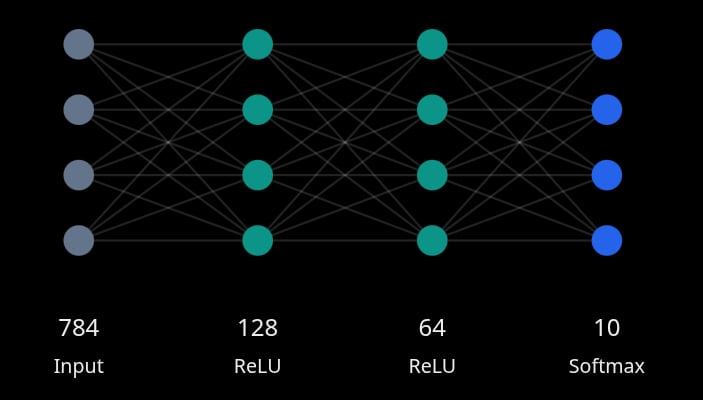

# MNIST Neural Networks from First Principles
### Mathematical Foundations, Implementation, and Computational Analysis

## Overview

### What the project is

Using the MNIST handwritten digit dataset, I built a multilayer neural network to explore forward propagation, backpropagation, activation functions, loss computation, and optimization. The goal isn't simply to classify handwritten digits, but to understand how each mathematical operation contributes to the learning process.

### Motivation

The increasing accessibility of machine learning frameworks has significantly simplified the implementation of neural networks. However, these abstractions can obscure the underlying mathematical operations, particularly for individuals attempting to understand how neural networks learn and optimize their parameters.

### Methodology

The project serves as a tangible output while learning the fundamental mathematics used for Artificial Intelligence, by building it from the ground up using Pure Python implementation, without using any NumPy and PyTorch or TensorFlow libraries throughout the start. 

The project also encourages the use and need for low level implementations of several functions, such as a summation function made with pure python, or the crucial mathematical functions used in Machine Learning, such as the dot product, softmax and more.

## Neural Network Architecture

### 4 Layered Neural Network

This design is suitable enough for a MNIST Handwritten Digit Classifier Network. The whole purpose of the project is to learn the core ideas or the fundamental mathematics of a neural network.

